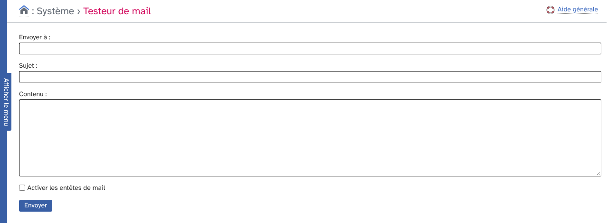
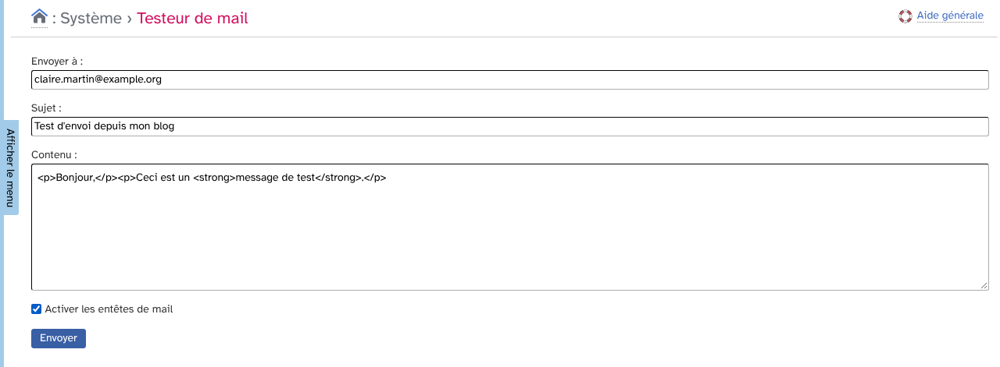
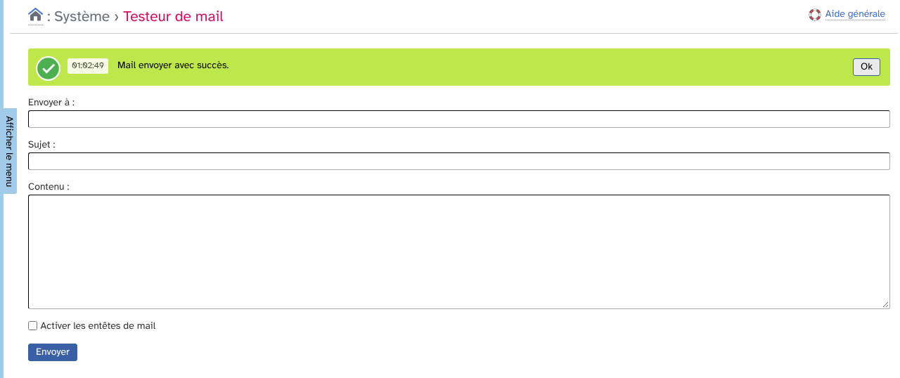
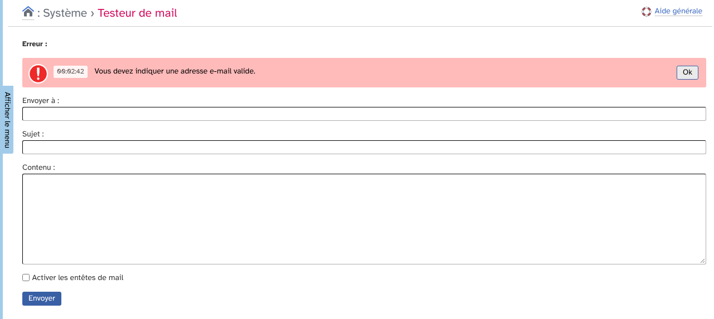

# testMail : guide d'utilisation

testMail envoie un mail de test depuis l'administration de Dotclear. Il sert à vérifier que votre blog sait envoyer des mails.

## Sommaire

* [Ouvrir le testeur](#ouvrir-le-testeur)
* [Envoyer un mail de test](#envoyer-un-mail-de-test)
* [Activer les entêtes de mail](#activer-les-entêtes-de-mail)
* [Si ça ne marche pas](#si-ça-ne-marche-pas)
* [À savoir](#à-savoir)

## Ouvrir le testeur

Dans le menu *Plugins*, cliquez sur *Testeur de mail*.

Cette page est réservée aux super administrateurs.

## Envoyer un mail de test

Remplissez le formulaire :

* *Envoyer à* : l'adresse du destinataire. Utilisez une adresse que vous pouvez consulter.
* *Sujet* : le sujet du mail.
* *Contenu* : le texte du mail.

Cliquez sur *Envoyer*. Un message vert confirme que le mail a été envoyé.

Le message vert veut dire que Dotclear a remis le mail au système d'envoi du serveur. Il ne garantit pas que le mail est arrivé. Vérifiez la boîte du destinataire, et le dossier des courriers indésirables.

## Activer les entêtes de mail

Cochez *Activer les entêtes de mail* avant d'envoyer. Le mail est alors envoyé comme Dotclear envoie ses propres mails :

* le contenu est lu comme du HTML, en UTF-8 ;
* l'expéditeur est le nom du blog, avec une adresse `no-reply@` suivie du nom de domaine du blog ;
* des entêtes décrivent le blog : son identifiant, son nom et son adresse ;
* l'adresse IP de la personne qui envoie le mail est ajoutée.

Sans la case cochée, Dotclear envoie un mail simple, avec les entêtes par défaut du serveur.

Cette option sert à voir comment votre fournisseur de mail ou votre filtre anti-spam réagit aux mails de votre blog.

## Si ça ne marche pas

Si l'adresse n'est pas valide, un message d'erreur rouge s'affiche. Il en est de même si le contenu est vide.

Le formulaire est alors vidé : saisissez de nouveau l'adresse, le sujet et le contenu.

Si le message de succès s'affiche mais que rien n'arrive :

* regardez dans le dossier des courriers indésirables ;
* essayez avec une autre adresse, chez un autre fournisseur ;
* vérifiez que votre hébergement permet l'envoi de mail depuis PHP.

## À savoir

* L'aide de la page (lien *Aide générale* en haut à droite) rappelle l'essentiel de ce guide.
* Le plugin n'enregistre rien : il ne garde ni l'historique des envois, ni les adresses saisies.
